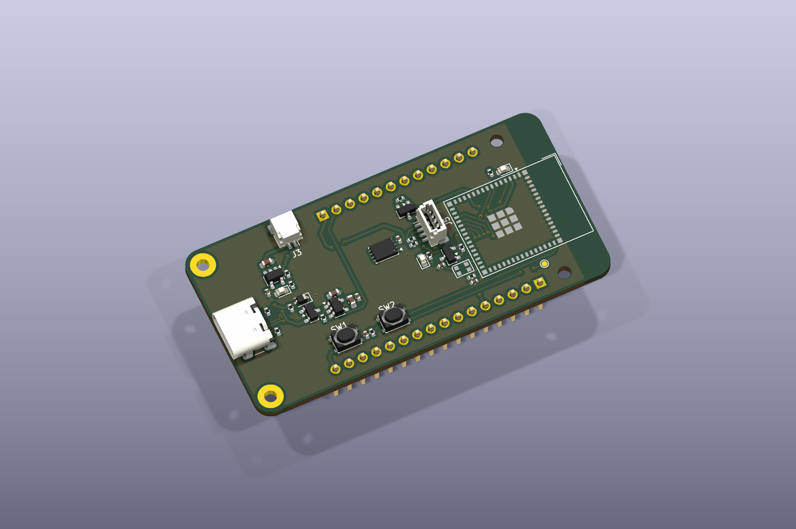

# ESP32-S3 Development Board - Visual Guide

CAD views generated from the packaged source files using KiCad 10.0.5.

*Angled top view. The assigned U2 ESP32 module and D4 LED models are unavailable; their footprints remain present in the design.*

| Visual | Description |
| --- | --- |
| [3D CAD render](images/pcb-3d-render.png) | Angled top view using the available component models. |
| [Front PCB layout](images/pcb-front.svg) | Front copper, front silkscreen, and board outline; viewed from the top. |
| [Back PCB layout](images/pcb-back.svg) | Back copper, back silkscreen, and outline; mirrored to show the underside. |
| [Schematic overview](images/schematic-overview.png) | Single-sheet preview; use the PDF for readable detail. |
| [Complete schematic](../exports/schematic.pdf) | Vector PDF of the complete circuit. |

*Front copper, front silkscreen, and board outline.*

*Back copper and silkscreen, mirrored to show the underside.*
