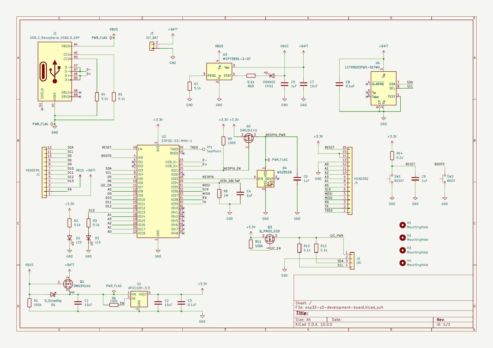

# Design Gallery

[Project overview](../README.md) · [Schematic PDF](../exports/schematic.pdf) · [Verification](checks/README.md)

Native exports from the packaged KiCad 10.0.5 design. Layout SVGs and the schematic PDF provide scalable detail.

## Front PCB layout

Top view showing front copper, front silkscreen, and the board outline.

## Back PCB layout

Underside view showing back copper, back silkscreen, and the board outline. The export is mirrored for this viewing direction.

## Schematic

Single-sheet overview. Open the [schematic PDF](../exports/schematic.pdf) for readable circuit detail.

## 3D CAD view

Angled top view of the board and available component models.

**Model coverage:** the installed library lacks the assigned U2 ESP32 module and D4 LED bodies. Their footprints are present in the PCB. Mounting holes and the test point have no assigned component-body models.
